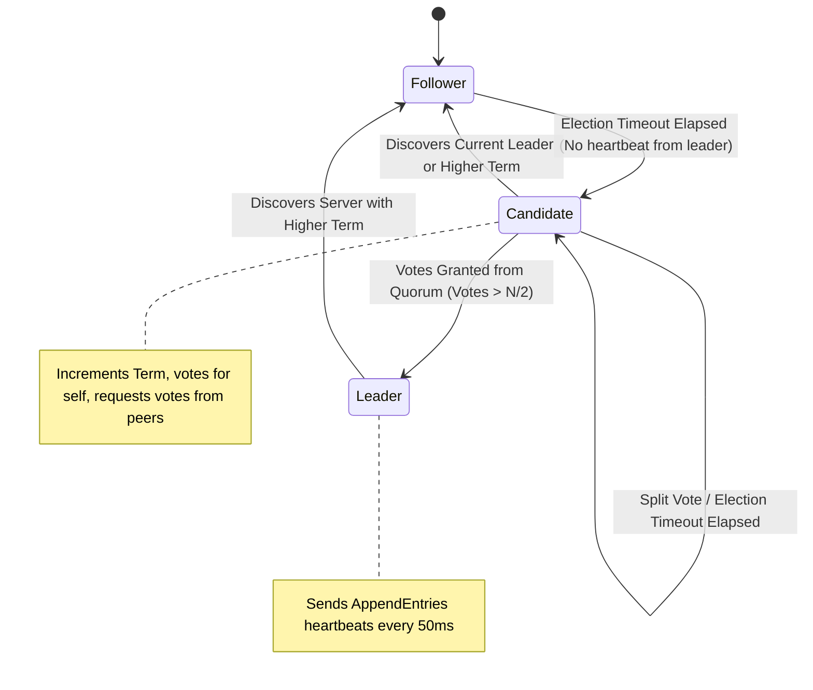

# Raft Distributed Consensus Engine from Scratch

[](https://github.com/nauman/raft-consensus-engine/actions)
[](https://go.dev/)
[-blue)](https://raft.github.io/raft.pdf)
[](LICENSE)

A standalone implementation of the **Raft Distributed Consensus Protocol** written from the ground up in Go. Implements **leader election with randomized jitter timeouts**, **log replication across quorums**, **state machine commitment**, and **automatic failover recovery**.

Designed strictly against the Stanford Raft specification (*"In Search of an Understandable Consensus Algorithm"* by Diego Ongaro and John Ousterhout).

---

## Raft State Machine Lifecycle



---

## Core Consensus Mechanics

### 1. Leader Election (§5.2)
- Nodes start in the `Follower` state. If a follower hears no communication from a leader over a randomized election timeout window (**150ms to 300ms** with randomized jitter), it assumes the leader has failed and transitions to `Candidate`.
- The candidate increments its `currentTerm`, votes for itself, and broadcasts `RequestVote` RPCs to all peers.
- A candidate wins the election if it receives votes from a strict majority (**quorum**: $> N/2$) of cluster nodes.

### 2. Log Replication (§5.3)
- Once elected, the leader handles all client mutations via `SubmitCommand(cmd)`.
- The leader appends the command to its local log and broadcasts `AppendEntries` RPCs to all followers.
- When an entry has been safely replicated across a quorum of followers, the leader increments `commitIndex` and applies the command to its state machine.

### 3. Log Consistency Invariant
- If two entries in different logs have the same index and term, they store the same command.
- If two entries in different logs have the same index and term, their logs are identical in all preceding entries.

---

## RPC Specifications

1. **`RequestVote(args RequestVoteArgs)`**:
   - `Term`: Candidate's term.
   - `CandidateID`: Candidate requesting vote.
   - `LastLogIndex`, `LastLogTerm`: Candidate's latest log entry metadata (ensures voters never elect a candidate whose log is less up-to-date than their own).
2. **`AppendEntries(args AppendEntriesArgs)`**:
   - `Term`: Leader's current term.
   - `LeaderID`: Redirect target for clients.
   - `PrevLogIndex`, `PrevLogTerm`: Consistency check anchor point.
   - `Entries[]`: Empty for periodic heartbeats (50ms); populated during replication.
   - `LeaderCommit`: High-water mark of committed entries.

---

## Quickstart (Run in 2 Minutes)

### Option 1: Docker Compose
```bash
docker compose up --build
```
The demo cluster dashboard runs on `http://localhost:8095`.

---

### Option 2: Local Go Setup
```bash
# 1. Run unit consensus & election failover tests
make test

# 2. Start the interactive 3-node cluster
make run
```

---

## Interactive Cluster Demo Walkthrough

### 1. Inspect Cluster State & Elected Leader
```bash
curl http://localhost:8095/status
```
**Response:**
```json
{
  "cluster": "3-node-raft",
  "nodes": [
    {"id": "node-alpha", "role": "Follower", "term": 1},
    {"id": "node-bravo", "role": "Leader", "term": 1},
    {"id": "node-charlie", "role": "Follower", "term": 1}
  ]
}
```

### 2. Submit a Replicated Command to the Leader
```bash
curl "http://localhost:8095/command?cmd=SET%20cluster_region%20us-east"
```
**Response:**
```json
{
  "status": "submitted",
  "leader_id": "node-bravo",
  "term": 1,
  "log_index": 1,
  "success": true
}
```
The command is replicated across `node-alpha` and `node-charlie`, and committed into the distributed state machine.

---

## Project Structure

```
.
├── cmd/
│   └── cluster-demo/          # 3-node in-memory cluster & HTTP dashboard
├── pkg/
│   └── raft/
│       ├── models.go          # Roles, LogEntry, RequestVote & AppendEntries RPCs
│       ├── node.go            # State machine, timers, and RPC handlers
│       └── raft_test.go       # Election, replication & failover tests
├── Dockerfile                 # Minimal multi-stage container
├── docker-compose.yml         # Container stack
├── Makefile                   # Build, test, and run automation
└── README.md
```

---

## License
MIT License.
